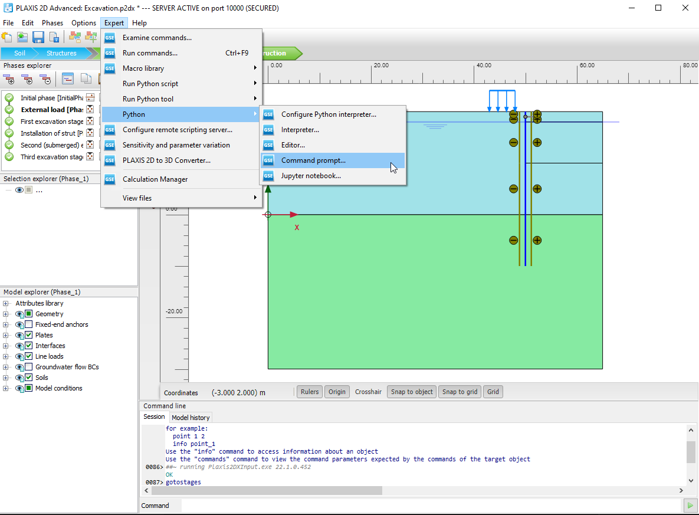
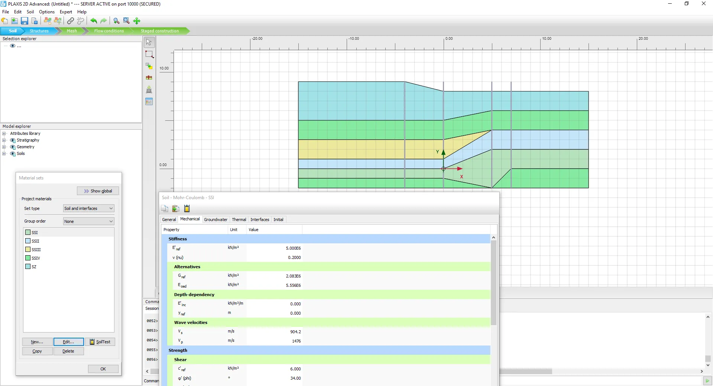

# PLAXIS 2D Models From Excavation to Response

PLAXIS 2D represents geotechnical deformation, groundwater conditions, and soil-structure interaction in a two-dimensional finite element model.
A useful analysis connects its construction sequence to material assumptions and identifiable results.

[](https://plaxis-2d.github.io/plaxis-2d/)

## Describe what changes during construction

Write down the initial ground condition and the sequence of excavation, loading, and support installation.
Choose plane strain or axisymmetric geometry to match the physical idealization.
A two-dimensional section needs a documented explanation of the features it represents.

1. Define the stratigraphy and initial groundwater conditions.
2. Establish the initial stress state and applicable boundaries.
3. Activate or remove soil volumes and structural components by phase.
4. Assign drainage and calculation settings for each stage.
5. Identify the locations and response quantities needed for review.

The [PLAXIS 2D product overview](https://www.seequent.com/products-solutions/plaxis-2d/) describes the available analysis workflows.
The constant-strain check in [test_tri31-strain.py](tests/test_tri31-strain.py) is a plane-stress example that illustrates why the chosen element formulation matters.
Its assumptions differ from a plane-strain geotechnical section.

For repeated model preparation, the installed PLAXIS Input program can start with a scripting port and password.
In PowerShell, define the executable, available port, and password in the corresponding environment variables first:

```powershell
& $env:PLAXIS_INPUT_EXE `
  "--AppServerPort=$env:PLAXIS_INPUT_PORT" `
  "--AppServerPassword=$env:PLAXIS_PASSWORD"
```

The [vendor automation guide](https://bentleysystems.service-now.com/community?id=kb_article_view&sysparm_article=KB0049677) documents these switches.
The command launches Input; a calculation still requires a model, valid phase settings, and the appropriate installed license.

## Give water conditions their own calculation history

A phreatic level, excess pore pressure, and a prescribed drainage boundary describe different aspects of a model.
Decide which conditions exist initially and which change during each construction stage.
Check whether the question concerns an immediate response, dissipation over time, or coupled flow and deformation.

The consolidation example [test_ssp-quad-up.py](tests/test_ssp-quad-up.py) includes pore-fluid storage and a transient response.
The three-dimensional body-force checks in [test_brick-up-body-force.py](tests/test_brick-up-body-force.py) examine reactions in coupled solid-fluid elements.
Both provide references for inspecting assumptions and equilibrium in a simplified setting.



Record the permeability units, time units, and drainage settings with the analysis.
Compare the pore-pressure history with the intended physical sequence before interpreting a displacement contour.
The [PLAXIS general information manual](https://files.seequent.com/PLAXIS/Manuals/PLAXIS_2D/English/PLAXIS_2D_0-General%20Information%20Manual.pdf) distinguishes groundwater flow, excess pressures, and coupled analyses.

## Keep soil response separate from support idealization

### Structural components

Represent walls, anchors, reinforcement, and interfaces according to the load-transfer mechanism being studied.
Check activation timing, connection behavior, and stiffness units for each component.
A structural force should be interpreted together with the surrounding ground response.

The cantilever example [test_force-beam-column.py](tests/test_force-beam-column.py) checks a force-based beam-column response.
Load equilibrium and fixed-end behavior are examined in [test_mod_elastic_beam_loads.py](tests/test_mod_elastic_beam_loads.py).

### Material behavior

For bentley plaxis 2d material selection, connect stiffness, strength, drainage, and loading history to the intended analysis.
Review whether the required behavior is represented before refining a parameter set.
Separate a material calibration question from a mesh or boundary-condition question.

The viewer setup [strain.tcl](SCRIPTS/strain.tcl) and its sample definitions [uniaxialMaterials.tcl](SCRIPTS/uniaxialMaterials.tcl) illustrate inspecting uniaxial stress-strain behavior.
Parameter sensitivity is examined in [test_concrete02_sensitivity.py](tests/test_concrete02_sensitivity.py) and [test_concrete02is_sensitivity.py](tests/test_concrete02is_sensitivity.py).
The cyclic reconnection case [test_hystereticsm_reconnection.py](tests/test_hystereticsm_reconnection.py) provides another constitutive-response example.

These material examples concern structural constitutive laws; they do not supply calibrated PLAXIS soil parameters.
Keep the source and intended use of each material parameter visible in the model record.

## Separate a physical response from a numerical effect

### Dynamic inputs and carried-over state

When using dynamic analysis, track the input motion, time step, mass assumptions, and preceding construction history.
Confirm the meaning of the reported displacement or acceleration before comparing it with another result.

The input-motion checks in [test_ground_motion_derivation.py](tests/test_ground_motion_derivation.py) examine velocity and acceleration behavior.
The inertia checks in [test_elastic_beam_ground_motion.py](tests/test_elastic_beam_ground_motion.py) address beam ground-motion loading.
The particle example [test_particle-dynamics.py](tests/test_particle-dynamics.py) compares a simple response with known mechanics.
The staged sensitivity case [test_sensitivity_after_loadconst.py](tests/test_sensitivity_after_loadconst.py) follows a gravity-loading stage with transient analysis.

### Mesh, solver, and result checks

For plaxis 2d software studies, vary one numerical choice at a time while retaining the same physical problem.
Record the response quantity used to judge whether the change matters.

| Review question | Compare across runs | Keep documented |
| --- | --- | --- |
| Mesh dependence | Displacement or structural response at the same location | Local refinement and element choice |
| Boundary influence | Response after changing domain extent | Boundary type and distance |
| Time resolution | Response history at smaller time steps | Loading duration and drainage assumptions |
| Safety calculation | Strength-reduction development and deformation mechanism | Starting phase and calculation settings |

PLAXIS safety calculations use phi/c reduction to evaluate global stability.
The [reference manual](https://files.seequent.com/PLAXIS/Manuals/PLAXIS_2D/English/PLAXIS_2D_2_Reference%20Manual.pdf) describes reducing strength parameters and interpreting the calculation.

The robustness checks in [test_bandgen_solver.py](tests/test_bandgen_solver.py) exercise a band solver with problematic input.
The low-level arithmetic checks in [test_matrix_vector_otherfact.cpp](tests/test_matrix_vector_otherfact.cpp) are registered through [CMakeLists.txt](tests/CMakeLists.txt).
The dependency finder [FindARPACK.cmake](cmake/cmake/FindARPACK.cmake) locates an eigenvalue-analysis library for the companion code.

## Extract results with a phase and unit attached

Open the calculated project in PLAXIS Output and enable its Remote Scripting server.
Use a compatible PLAXIS Python environment with the installed scripting wrapper.
The Output connection has its own port, which must match the active server.

With the server host, port, and password supplied through environment variables, this example reads vertical soil displacement from the last phase in Output:

```python
import os
from plxscripting.easy import new_server

s_o, g_o = new_server(os.environ["PLAXIS_HOST"],
    int(os.environ["PLAXIS_OUTPUT_PORT"]), password=os.environ["PLAXIS_PASSWORD"])
phase = g_o.Phases[-1]
uy = g_o.getresults(phase, g_o.ResultTypes.Soil.Uy, "node")
print("Phase:", phase.Name.value, "Uy range:", min(uy), max(uy))
```

Choose the intended calculated phase explicitly for a production report and confirm that it contains soil-node results.
Report the model's displacement unit, sign convention, and spatial scope with the extracted values.
The [official Output example](https://bentleysystems.service-now.com/community?id=kb_article_view&sysparm_article=KB0108979) demonstrates retrieving nodal coordinates and vertical displacements.



The utility [toOpenSeesPy.py](SCRIPTS/toOpenSeesPy.py) translates OpenSees Tcl commands into Python-oriented output.
The verification notes [README.md](tests/README.md) describe the companion test scripts and their import conventions.
Keep example execution separate from a project calculation whose inputs and results must remain traceable.

For plaxis 2d ultimate workflows, confirm the installed edition's available analysis types before defining an automated sequence.
Retain the model revision, calculation phase, material assumptions, and extraction script alongside the result.

## Related Search Terms

plaxis 2d, plaxis 2d, bentley plaxis 2d, plaxis 2d software, plaxis 2d ultimate, geotechnical-engineering, finite-elements, fem, soil-mechanics, groundwater, consolidation, soil-structure-interaction, numerical-methods, simulation, python
